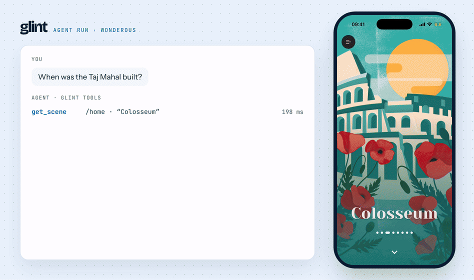
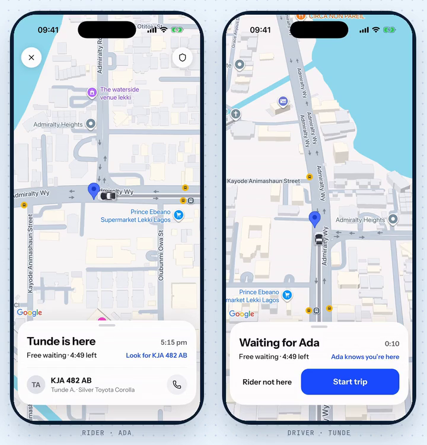

# glint

**Let an AI agent use your Flutter app the way a person would.**



You tell an agent what you want done — "sign in as test@example.com, find the order from yesterday, and cancel it" — and it taps, scrolls, and types its way through your app on a simulator until it's done. The app doesn't need to be modified. No package to add. No init code. Glint reads your running app from the outside and drives it through native input.

> **Status:** pre-1.0 and in daily use. Tool names and arguments can still change between versions. Design notes live in [`source-of-truth.md`](./packages/glint_mcp/source-of-truth.md).

---

## Install

glint needs the Dart SDK, which comes with Flutter.

**Claude Code plugin.** One plugin brings both servers, glint and glint network:

```
/plugin marketplace add Lukas-io/glint
/plugin install glint@glint
```

The first start installs the servers from pub.dev (about 20 seconds); run `/mcp` to reconnect if it times out. Details are in [plugin/README.md](plugin/README.md).

**Any MCP host.** Install from pub.dev, with `~/.pub-cache/bin` on your `PATH`, and add the `glint` command:

```bash
dart pub global activate glint_mcp

# For example, Claude Code:
claude mcp add glint -- glint
```

To run it from a checkout instead:

```bash
git clone https://github.com/Lukas-io/glint.git
cd glint && dart pub get
claude mcp add glint -- dart run "$PWD/packages/glint_mcp/bin/glint.dart"
```

On iOS, `attach` reports the Xcode version and which bridge it found. It looks for `GLINT_IOS_BRIDGE`, then a build inside the glint checkout, then `~/.glint/bin/glint-iossim-<version>`, and otherwise downloads the bridge attached to the matching GitHub Release, checked against its published sha256 (`GLINT_NO_BRIDGE_DOWNLOAD=true` turns that off).

Android needs `adb` on your `PATH` or `ANDROID_HOME` set. Then run your app with `flutter run` on a simulator or emulator and ask the agent to call `attach` with no arguments; glint finds the app and the device.

## In plain language

Today, if you want an agent to drive a Flutter app, your options are bad:

- **Screenshot + vision model.** Slow, expensive, and the agent is guessing where to tap from pixels. Misses anything that isn't visually obvious.
- **Add a test package to your app.** Now you're shipping testing code in your real codebase, and you can't run it on the same build your users use.
- **Build it yourself.** Months of VM-service spelunking and platform input gluework.

Glint is the third option, done for you, and built so the agent runs as fast as a person — sometimes faster.

It works by reading the **live state of your running app** (via the Dart VM service in debug mode) and sending **real OS-level taps** to the simulator. So the agent always knows what's actually on screen, what's actually tappable, and where it is in your navigation stack. The agent can also arm its next move against a target that isn't on screen yet, and glint fires it as soon as the target appears and can take the tap.

## What it does (today's scope)

- **Drives any Flutter app** on the iOS Simulator or Android Emulator. No modification to the app required.
- **Acts**: tap, long press, double tap, swipe, drag, scroll, type text, key events, and hardware buttons (home, lock, volume, back).
- **Sees**: every element on screen with two truths: `painted` (is a human looking at it?) and `hittable` (is nothing above it blocking taps, such as an `IgnorePointer` or `AbsorbPointer`?). An opaque sibling drawn on top is not detected yet.
- **Orients**: knows the navigation stack, including dialogs and bottom sheets, not just routes.
- **Describes**: gives the agent a compact plain-language scene, not a coordinate dump.
- **Shows its touches**: `attach showTouches:true` draws each tap, swipe and drag on the app, so people watching the simulator or a recording can follow along.
- **Scrolls to find**: virtualized lists only build what's near the viewport — glint will scroll to bring an off-screen item into the tree as a first-class action.
- **Location and maps**: `location` sets the GPS position or plays a route in the background (points, GPX, KML or a polyline), sets or answers location permissions, and waits for arrival. `get_scene` reads a Google map's camera, markers, routes and areas, with the screen point of each marker, and `map` taps markers, pans and zooms like a finger.

## Two devices at once (rider and driver)



One prompt, two live apps: *"Drive Tunde to Ada's pickup. Tell me when her app says he's there."* The agent:

1. `location op:route polylineId:"route" speedKmh:70 maxSpeedKmh:100` on the driver's phone. glint drives the route the app draws on its map (polyline id `route`), with speed that varies like a driver's and slows for each turn.
2. `location op:wait until:"arrived"`, with progress every 15 s.
3. `tap text:"Arrived"` on the driver's phone.
4. `get_scene` on the rider's phone, which now reads "Tunde is here".

One glint session can hold apps on several devices: `attach` again adds one, and `device:` on `location` picks which device moves. [`examples/glint_ride`](./examples/glint_ride) is the rider and driver app in the video, two roles in one Flutter app linked over a local socket.

## What makes it fast

Most agent loops look like: act, wait for screen to settle, model wakes up, reads, decides, acts again. Every "wake up" is a full LLM round trip. Glint kills this with **armed intent**:

1. The agent reads the screen *and* peeks at the widget tree (what's about to appear).
2. It declares its next move ahead of time — even against a target that isn't on screen yet.
3. Glint holds the intent and checks the scene every 100 ms. As soon as the target is present and nothing above it blocks taps, the action fires.
4. If the prediction was wrong, a structured "catch" wakes the agent with the actual state.

The agent only spends thinking time on (a) deciding what's next and (b) handling catches. When the prediction holds, the flow runs at server speed.

## What's deliberately not in scope (v1)

- **Not a testing tool.** No assertions, no test runner. We're building task execution, not verification. Recap (record-and-replay with metrics) is on the roadmap.
- **No animation handling.** v1 acts on settled states.
- **No multi-touch on Android.** Pinch/rotate need raw `sendevent` and are deferred.
- **No real devices.** Simulators and emulators only, debug mode only.
- **No CLI for humans.** Agent-first; a human-driven interface is future work.

Full scope and non-goals: see [`source-of-truth.md`](./packages/glint_mcp/source-of-truth.md) §4–§5.

## Technical sketch

Four modules behind an MCP server (stdio transport for v1):

| Module | Job | How |
|---|---|---|
| **A — Interaction** *(hands)* | Native input on the simulator | Swift bridge against `CoreSimulator.framework` for iOS; `adb shell input` for Android |
| **B — Perception** *(eyes)* | Read the live render tree | Dart VM service. Surfaces `painted` and `hittable` separately. Coordinates resolved lazily — never cached. |
| **C — Semantic layer** *(understanding)* | Plain-language scene the agent reads | Derived from render primitives, zero-config |
| **D — Instruction layer** *(grammar)* | Tool grammar + worked examples + gotchas | Treated as first-class; an MCP tool is only as good as the instructions shipped with it |

Built in Dart on top of `package:dart_mcp`, `package:vm_service`, and `package:dtd` — sharing hardened patterns with [glint_network](./packages/glint_network) where they apply (DTD discovery, structured response shapes, AOT install flow).

Tested on Flutter 3.47 (Dart 3.13), debug builds. Older Flutter versions are not tested yet; a version matrix in CI is planned.

## Roadmap

v1 focuses on **discovery-mode task execution** — making the first run through a flow fast and accurate. Beyond v1:

- **Persona-driven user testing.** Hand the agent a user persona; have it use the app the way that persona would, including the wandering and naive behaviour. Built as a separate product on top of glint's core.
- **Recap (record-and-replay).** For known flows. Replay has no per-step thinking — this is how you beat a human on repetitive tasks.
- **Custom widget enrichment.** Out-of-band map of semantic descriptions for custom widgets. Never an edit to the app.
- **Animation + transform awareness.** Correct coordinate resolution inside animating subtrees.
- **Multi-touch on Android.** Pinch and rotate via `sendevent`.
- **Real device support.** Constrained by native input injection paths.
- **Non-MCP interface.** CLI / UI for humans driving the same capabilities directly.

Full roadmap: [`source-of-truth.md`](./packages/glint_mcp/source-of-truth.md) §11.

## Limits today

- **Debug and profile builds only.** glint reads the app through the Dart VM service, which release builds don't have.
- **iOS needs a Mac with Xcode 26 or 27.** The simulator bridge uses private simulator APIs, so each Xcode major is verified before glint allows it; the support table is in [`source-of-truth.md`](./packages/glint_mcp/source-of-truth.md) §13. On another Xcode major, `attach` warns and taps, swipes and typing are refused with `errorKind: unsupportedToolchain`; set `GLINT_ALLOW_UNTESTED_XCODE=true` to try anyway.
- **The prebuilt bridge is ad-hoc signed, not notarized.** Build it yourself if your machine requires notarized binaries.
- **Android runs over adb.** Tested on macOS hosts; Linux hosts are not tested yet.
- **Typing is ASCII only** on both platforms.
- **No Flutter web or desktop yet.**
- **Password fields show their length, never their text**, in scenes and logs.
- **Call tools one at a time when several apps are attached.** Parallel calls can act on the wrong app; per-app serialization is planned.
- **Maps: one finger, Google maps only.** `map` taps, pans and zooms in; zooming out needs two fingers, which glint does not have. Maps from other packages are not read.

## Privacy

glint records tool usage locally and sends nothing unless you set `GLINT_TELEMETRY=on`. See [TELEMETRY.md](./TELEMETRY.md) for exactly what is recorded and what would be sent.

## License

[Apache License 2.0](./LICENSE). You can use, modify, and ship glint in personal and commercial work. See [NOTICE](./NOTICE).

## Repository

This repository holds the glint packages, each versioned and released on its own:

| Package | What it is |
| --- | --- |
| [`glint_mcp`](./packages/glint_mcp) | The glint MCP server: reads the screen and drives the app. |
| [`glint_network`](./packages/glint_network) | The network toolset: HTTP, WebSocket and log capture from the same running app. |
| [`glint_core`](./packages/glint_core) | Code both servers share: redaction, the telemetry audit log, telemetry consent. |

## Contributing

Start with [CONTRIBUTING.md](./CONTRIBUTING.md). How changes, CI and releases work is in [MAINTAINING.md](./MAINTAINING.md), and the architectural decisions are in [`source-of-truth.md`](./packages/glint_mcp/source-of-truth.md). Report security problems privately, as described in [SECURITY.md](./SECURITY.md).
